# About KHEOPS

KHEOPS is saya's kernel pack. it only ever ships prebuilt bzImages, never source. for months saya, seuros and others on their side have told people that i steal their code and that my kernels are vibe coded.

i didnt answer with words. below is whats actually inside their kernels, what they said themselves, and whats inside the kernels that went around with my name swapped out. everything here can be checked.

i will keep updating this page, even when im bored. theres a lot of shit lol. this way people know whats really going on with ps4 linux.

## The teardown

KHEOPS v2.1 is 14 prebuilt kernels with no source. i took them apart, the 6.15.4 builds in detail. every point below has the addresses and bytes in my notes.

and that was on purpose. on july 27, before the release, someone asked saya "will the source be released with it?". he answered "NEVER". later he said he links the original trees and "le reste c'est mon travail" (the rest is my work). the gpl does not work like that. if you ship a kernel binary you ship the full source of it, your own changes included. linking crashniels tree does not cover the bridge changes he made.

where the code comes from:

- the base is crashniels public 6.15.y tree. their own file names even say it: `6.15.4.src-crashniels_KHEOPS_FullLTO-v2.1_...`. strings that only exist in his tree are in the binary, for example the `apcie_assign_irqs(%d) (%d)` format and the `ps4_bridge_get_modes` print at info level
- every gpu table in cik.c is byte identical to the public tree. 25 of 25 found, gladius included
- every ps4 driver string from `arch/x86/platform/ps4` and `drivers/ps4` is in the binary. 0 missing
- a full string scan against the whole crashniels tree finds no new code. the only new strings are the wifi driver
- wifi is not theirs either. its the yhpgi mt7668s unstable driver, moved into the tree with amorghus patch for 6.15.4
- the rest is public stuff: prjc bmq scheduler, ntsync, graysky cpu flags, tkg config patches

what they changed:

- the hdmi bridge. the 4k build offers one mode only, 3840x2160 at 60hz, and accepts nothing else
- the pci vendor check in the bridge enable is removed
- one bridge register write (`0x6020 = 0x00`) is dropped from the enable sequence. the rest of the 76 commands is the same as the source
- thats it. nothing in the gpu, nothing in the southbridge drivers

what is broken:

- the multi resolution builds offer 2160p60 and 4096x2160p60, then their own mode check rejects both. what you can really use is 1080p60, 1080p100, 1080p120, 720p and 2160p30
- the single resolution builds drop the preferred flag on their only mode, which crashniels added back in august 2025
- 5 of the builds have no wifi driver but still carry all 9 mt7668 firmware blobs

what is missing:

- hardware video. the binary has no liverpool uvd or vce firmware at all, so the video engines never start and everything decodes and encodes on the cpu. on october 23 GattoDev asked saya "yall got hardware transcoding yet?", he changed the subject to game tests. on november 10 someone asked him for the best distro for a pro "with hardware transcoding for movies". he talked about x11 and mesa 21 and skipped the transcoding part again. this tree has both, see the showcase

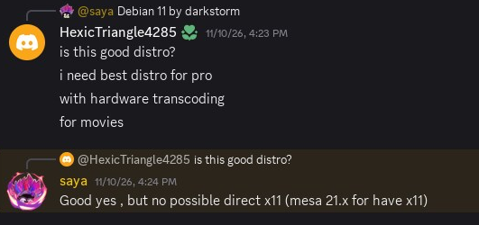

- edid. the bridge never reads your tv. it hands out a fixed list of modes and clears the edid. thats why saya tells people to make a fake `edid.bin` for their tv. on october 3 he blamed "the shit edid by bzImage rmux" for a 32" tv showing as 55" in fastfetch. that number comes from the tv itself. this tree reads the real edid from your tv over the hdmi bridge and passes it on

the firmware:

- the built in firmware list is the exact list string from feeRnts tree and mine
- all 9 mt7668 blobs are md5 identical to the ones in our `extra_firmware`

## "Just me"

on october 26 2026 gentoo corríjanme asked saya "who helped develop if you dont mind me asking? i would like to see all of them commended". saya answered:

> Just me, and a 6.15.4 base from crashniels.
> But keep in mind that a 5.x patch is usually 8 MB... whereas this patch is only 300 KB. I'll also add support for the MT7668 Wi-Fi chip; let me know if it works on your PS4.

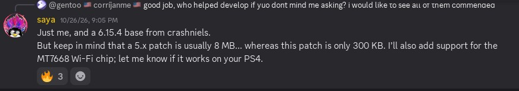

gentoo corríjanme is amorghus, same discord account. on september 28 amorghus posted `mt7668s-6.15.4.patch` in #talk and asked saya to add it. the KHEOPS wifi builds ship that exact port of the yhpgi mt7668s driver. so amorghus wrote the wifi part of KHEOPS, and saya still told him "just me".

the "300 KB patch" was never published, so nobody can measure it. what the binaries show is in the teardown above: a fixed mode list in the hdmi bridge, the pci vendor check removed, one register write dropped. everything else is crashniels tree, the yhpgi driver with the amorghus port, and public scheduler and config patches.

## 7.2.11 the next day

on october 27, one day after "just me, and a 6.15.4 base", saya posted this:

> kernel 7.2.11.src-crashniels-KHEOPS-FullLTO-v2.1_ntsync multiresolution

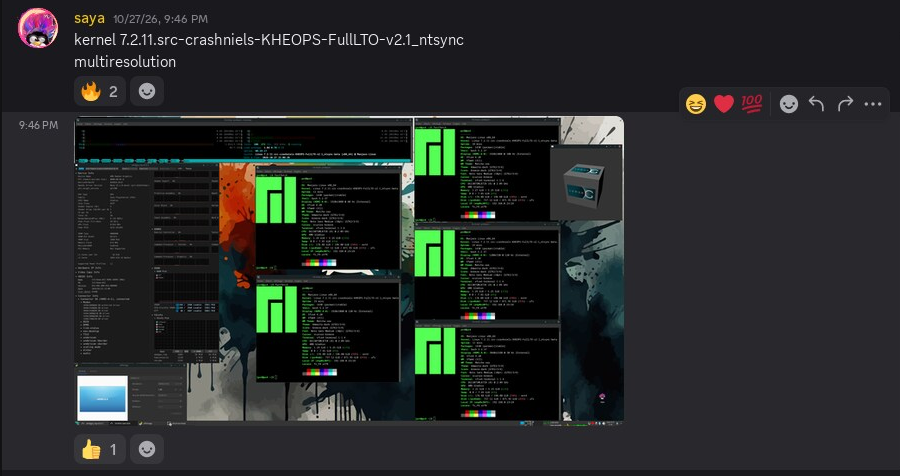

from 6.15 to 7.2 is 7 kernel releases: 6.16, 6.17, 6.18, 6.19, 7.0, 7.1 and 7.2. every one of them breaks the ps4 drivers. gpu breaks, usb breaks and more. so im sure without UART he wouldnt be able to do shit. he can barely speak english or french even. the table below shows how long that took in the open. he went from "a 6.15.4 base" to 7.2.11 overnight. that jump alone is already crazy.

the name says crashniels again. crashniels has no public 7.x ps4 tree. on github his newest ps4 branch is `ps4-linux-6.15.y`, and the ps4 patch set he added to `ps4-linux-patches` on october 18 2026 still uses a 6.15.4 config.

saya already said where his 7.x would come from. on may 25:

> This isn't the only source that's in 7.00+, there are plenty of versions already made

and on october 5, quoted in the 7.0 section below: "whether from this source or another".

on november 6 7.2.11 was "currently being finalized". still no source.

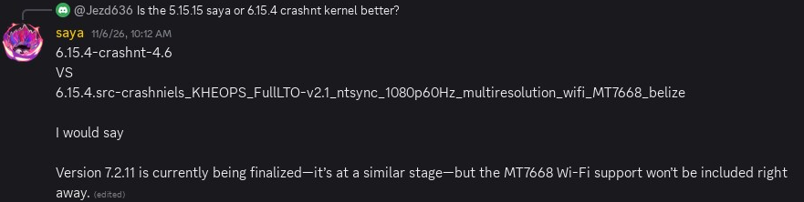

so my guess: its either a renamed 6.15.4, or just slopped and stolen code. because there is no source as usual 🤣

## Almost nine months on 6.15.4

on november 2 someone asked saya about btrfs on his baikal kernel. he answered:

> What is the point of Btrfs? That's the real question... For what it's worth, I've been testing Btrfs for two years now; I even released a Linux Mint-based distribution (derived from Blackdragon) that uses Btrfs for its internal image.

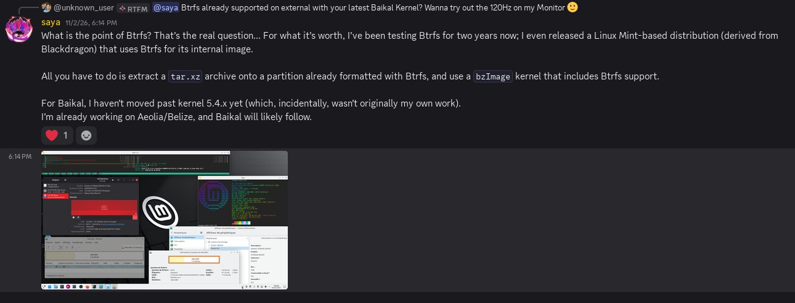

the screenshot he attached, full size:

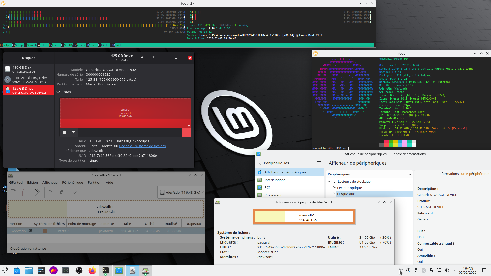

his own htop says `Linux 6.15.4.src-crashniels-KHEOPS-FullLTO-v2.1-120Hz` and `2026-02-05 18:50:46`. fastfetch shows the same kernel. so he was on 6.15.4 KHEOPS v2.1 since at least february 5 2026. it stayed 6.15.4 until october 26. then 7.2.11 one day later, and 7.4-rc1 two weeks after that.

a few more things in the same picture:

- "What is the point of Btrfs?". on october 5 he called himself "the first to pack a bzImage kernel with so many features: NTFS, Btrfs, full LTO, zram"
- his "Linux Mint-based distribution" is, by his own words, "derived from Blackdragon"

## 7.4-rc1, two days after my release

on november 10 2026 we released Strawberry 7.3.3 here.

on november 12 at 5:31 saya posted "7.4-rc1 ps4". his fastfetch says `Linux 7.4.0-rc1.src-crashniels-KHEOPS-FullLTO-v2.1_ntsync` on an AMD Gladius. htop shows `2026-11-12 05:29:51` with 4 minutes uptime.

his fastfetch also shows the display as `HDMI-A-0`. on x11 fastfetch reads the `EDID` property of the output. if there is one, it shows the monitor model from it. if there is none, it shows the connector name. so his 7.4-rc1 still gives out no edid, same as the 6.15.4 builds in the teardown. our bridge reads the real edid over icc since `amdgpu: ps4_bridge: read the edid over icc and handle hotplug`. his 7.4-rc1 shows no sign of that.

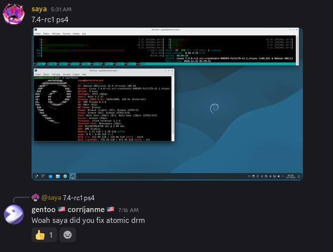

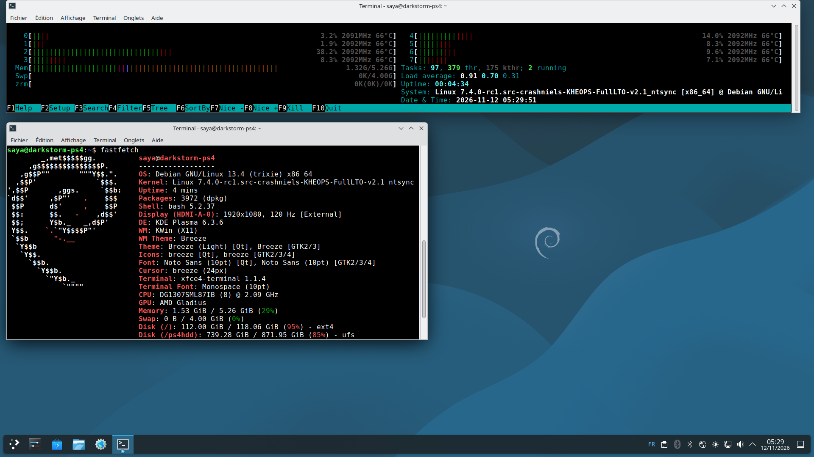

his own timeline:

| date | what saya said or posted |
|---|---|
| february 5 | already running 6.15.4 KHEOPS v2.1, see below |
| october 26 | "Just me, and a 6.15.4 base from crashniels" |
| october 27 | 7.2.11 |
| november 6 | 7.2.11 "currently being finalized" |
| november 10 | my 7.3.3 release, with source |
| november 10 | "I have now migrated to version 7.2.11, but without adding any "gamer" patches" |
| november 12 | 7.4-rc1 |

the november 10 message, same day as my release:

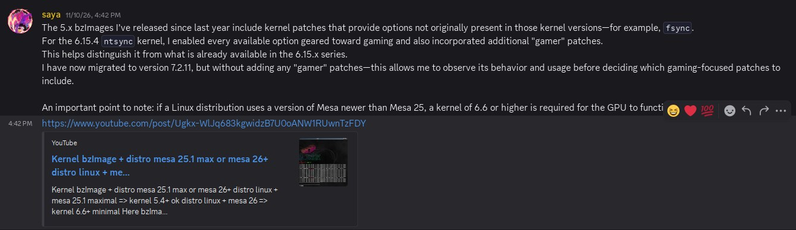

in it he says the 6.15.4 kernel got "every available option geared toward gaming" plus extra "gamer" patches. the teardown shows what those are: prjc bmq, ntsync, graysky cpu flags and tkg config patches, all public. and by his own words 7.2.11 has none of them.

so 7.2.11 was still not done on november 6, "migrated" on november 10, then 7.3 got skipped completely, and 7.4-rc1 shows up two days after our 7.3.3. the name still says crashniels, and crashniels still has no public 7.x ps4 tree. and still no source 🤣

i cant prove he used our source. there is nothing of his to compare it against. but going from 7.2.11 to 7.4-rc1 in two days, skipping 7.3, all by himself? no fucking way he jumps that high.

on november 12 GOAT asked him the same thing: how did he move crashniels 6.15 to 7.4 and deal with the old bridge hooks that are gone in 7.3. he also asked for a boot log or the bzImage.

that question is real. in upstream 7.2 `struct drm_bridge_funcs` still has `enable`, `disable`, `pre_enable` and `post_disable`. in 7.3 all four are gone, and the ps4 bridge driver uses all four. our `ps4: port to linux 7.3` commit adds them back and gives the bridge the atomic state helpers. saya answered:

> No , this sect insult my team ...no comment

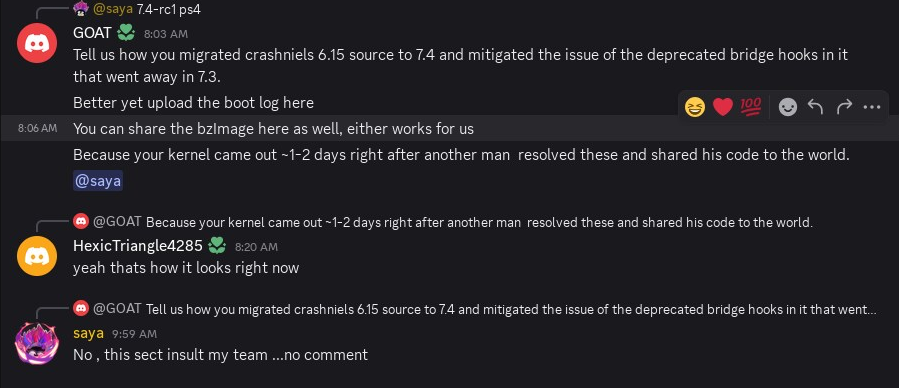

he did not post a boot log or the bzImage.

like the guy just asked how he did it and he thinks its an insult or what?????? this lowk makes no sense lmao

## Moving the kernel forward

KHEOPS is still on the 6.15.4 crashniels base, saya says so himself above. these are the public branches we moved forward from that same base, in [sony-jaguar-devs/ps4-linux](https://github.com/sony-jaguar-devs/ps4-linux) and [rmuxnet/linux](https://github.com/rmuxnet/linux):

| kernel | branch |
|---|---|
| 6.15.4 | `6.15.4-aeolia-belize-crashniels` |
| 6.18.8 | `6.18.8-aeolia-belize` |
| 6.18.18 | `6.18.18-Strawberry` |
| 6.18.20 | `6.18.20-Strawberry` |
| 6.18.21 | `6.18.21-Strawberry` |
| 6.19.11 | `6.19.11-Strawberry` |
| 7.0 | `7.0-Clean` |
| 7.0.8 | `aeolia-belize/7.0.8-Stable`, `baikal/7.0.8-Stable` |
| 7.1.3 to 7.1.7 | `zaebiz/7.1.3-Stable`, `zaebiz/7.1.6-Stable`, `zaebiz/7.1.7-Stable` |
| 7.3.3 | `ps4/7.3.3`, this tree |

every step means the ps4 drivers have to build and boot on the new kernel again. for example `drm/amdgpu: fix ps4_bridge attach callback signature for 6.18` on march 15 2026. all of this has my name on the commits, or my teams lol.

## "we don't use AI"

on may 8 2026 saya wrote in the ps4linux discord: "Utilisez le travail de rmux sur le kernel et le mesa , nous on releasera quelque chose qui fonctionnera, nous on n'utilise pas l'ia" (use rmux's work on the kernel and mesa, we will release something that works, we don't use ai). on may 25: "Poor guy, the AI won't be able to help him with this problem."

on november 10 someone asked him how to make the kernel wait longer for the hdmi connection. he did not answer the question. he told him to ask an ai, and said he used one himself on 7.2.11:

> Get some help from AI—though it didn't manage to identify the problem for me on version 7.2.11 (I had to figure it out myself).

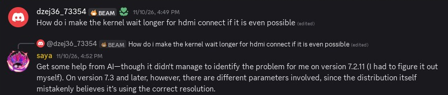

look at the punctuation too. for years saya never wrote an em dash (`—`). in the october and november screenshots on this page, 4 of his 13 messages have them. em dashes like that are typical ai text. when he writes a short answer himself, it looks like this: "No , this sect insult my team ...no comment". or this: "After i will released bzImages 7.x , i'm no stressed".

## 4K60 on a standard PS4

on october 23 saya wrote that he got 1080p at 120hz, 4k at 30 and "4K at 60fps on a standard PS4, you just have to find the right game".

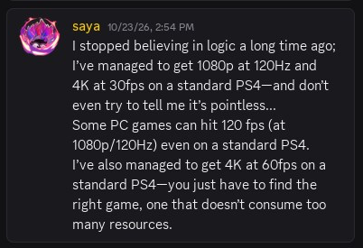

his own pack doesnt do that. the multi resolution builds offer 2160p60 and then reject it in their own mode check. the only build with 2160p60 is the 4k build, and the november 8 article for his pack says 4K60 is pro only. and a game that "doesn't consume too many resources" does not change the hdmi mode. the kernel sets the mode.

## DionKill

on october 31 someone said they used DionKill's distro before. saya answered:

> 5.4 , maximal mesa 25.x
> All kernel into @DionKill is a shit

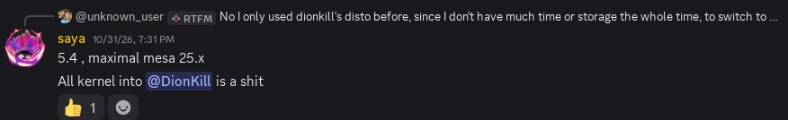

DionKill answered the next day with "???". MSI_Ins_Dir from their side replied "It's true". he gave no reason. same day he also wrote that their team doesnt have baikal, see the last section.

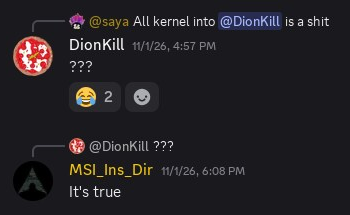

DionKill keeps [ps4-video-archlinux](https://github.com/DionKill/ps4-video-archlinux) up to date: mesa, libdrm and xf86-video-amdgpu on the latest stable versions, patched for the ps4 and pro gpus. it started as a fork of centi07's arch-ps4-aur, and 42 of the last 100 commits are his. he also keeps the [ps4-linux-tutorial](https://github.com/DionKill/ps4-linux-tutorial) up to date, last changed november 11 2026.

on september 27 amorghus said in #talk that the libdrm and xf86-video-amdgpu patches on his own setup come from DionKill's repo. thats the same amorghus whose wifi port is in KHEOPS.

saya tells people to go back to 5.4 and mesa 25. 5.4 is the kernel saya said on november 2 "wasn't originally my own work". his own youtube post says mesa 26 needs kernel 6.6 or newer. DionKill ships current mesa.

## The november 8 article

on november 8 2026 ps4linux.com posted "multi-resolution kernels for PS4 aeolia and belize released by saya, with 4K60, NTSYNC support, gaming patches and more" as a new release.

its download is the same KHEOPS v2.1 pack from october:

- file: `pack_bzImages-release_october_2026-KHEOPS-v2.1.zip`, 171685066 bytes
- sha256: `1d277fe849f3deae339d149581c6fdd39e064cd41679cb599df11df831a34907`, the same as the october copy i took apart above

so everything in the teardown still applies. the claims in the article against the binaries:

- "720p to 4K": the multi resolution builds offer 2160p60 and 4096x2160p60, then their own mode check rejects both. that is why the article tells you to switch back to 1080p60 every time
- "4K60 only on pro": the 4k build has one fixed mode, 3840x2160 at 60 hz, and nothing else
- "set 2160p rgb in orbis first": the bridge never reads your tv, so it depends on what gameos left behind. this tree reads the edid from the tv itself and offers the modes your tv lists
- "NTSYNC and FSYNC gaming patches": NTSYNC is a normal kernel option since 6.14, FSYNC (futex_waitv) since 5.16. turning on a config option is not a patch
- still no source, still no hardware video, still no baikal

## The 7.0 kernels

on may 8 2026 vvsx87 posted a "7.0.4 belize" kernel in the ps4linux discord. on may 9 saya showed off a "7.0.4.src-KHEOPS-FullLTO-v2.1_1080p60Hz_aeolia-belize" build. when people asked for the source he wrote "My source ... For you ? Never". he never released that kernel or its source.

on may 10 my baikal 7.0 bringup went into my tree. on may 14 and 15 vvsx87 posted "7.0.6 baikal" and "7.0.7 baikal" kernels. no source, no fork, no credit.

on may 25 saya posted a link to my readme and called it plagiarism. Diema asked him for evidence. he answered:

> I don't have that kernel, can't you see that's not a picture of me? When did you become an idiot?

Diema: "someone (you) who doesn't know the difference between fsync/ntsync working on the kernel seems highly unlikely. So I wonder if this is projection". saya: "This isn't the only source that's in 7.00+, there are plenty of versions already made".

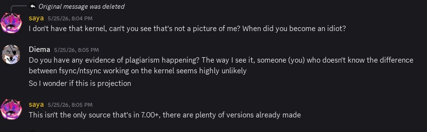

on october 5 saya explained himself how his 7.x would come out:

> Version 7.x will arrive... whether from this source or another. It doesn't matter if it comes from Team Kheops, a contributing member, or someone else entirely... I'll tweak it and implement all my own additions... my personal signature.

in the same message he calls himself "the first to pack a bzImage kernel with so many features: NTFS, Btrfs, full LTO, zram". those are config switches every kernel has.

## The 7.2.3 "Flawless" kernel

on september 5 2026 vvsx87 shared a kernel called `7.2.3-Flawless-NTSync-FullLTO`, built by `vvsx87@cachyos-ps4` that same morning. its own boot log prints my banner:

```
Strawberry PS4 Linux
Release   : 7.2.3-Flawless-NTSync-FullLTO
Builder   : vvsx87@cachyos-ps4
```

the binary has my code in it. none of this exists in crashniels tree, all of it was in my public tree months before:

- the strawberry banner. `init: add strawberry banner`, in my tree since may 2026
- `PS4 GPU IRQ: vector`, from `amdgpu: require MSI/MSI-X for PS4 Liverpool IRQs`, may 2026
- `PS4 fan hwmon ready`, my fan driver, may 2026
- `ps4-buzzer`, my buzzer driver, may 2026
- `ps4-cpufreq`, my cpufreq driver, august 2026

two weeks later, on september 18, he showed `7.2.6-Flawless-FullLTO`. the banner is still mine, line for line, he only swapped the word "Strawberry" for "Flawless":

```
Flawless PS4 Linux
Platform  : Sony PlayStation 4
Release   : 7.2.6-Flawless-FullLTO
Builder   : vvsx87@vvsx87-artix
```

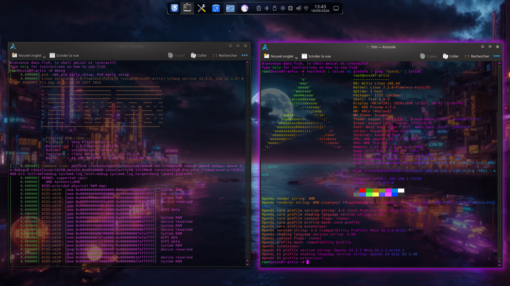

same day his "PS4 LED Control" app shows the exact patterns of my led driver from march 2026: orange white, pulsate orange, orange white blue, violet blue, pink, pink blue, purple.

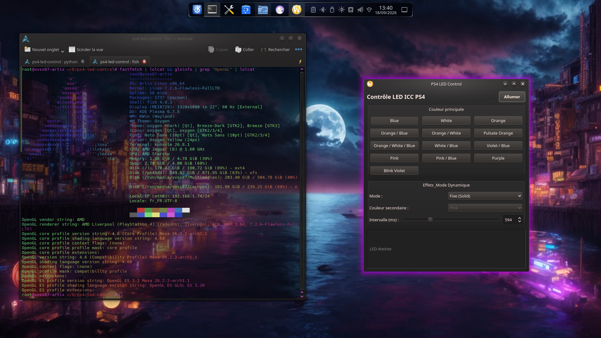

my tree with a new name and a bumped version. thats why i made the source private that same day, and why its public again now with every commit and author in it.

his own screenshot from that morning, running it:

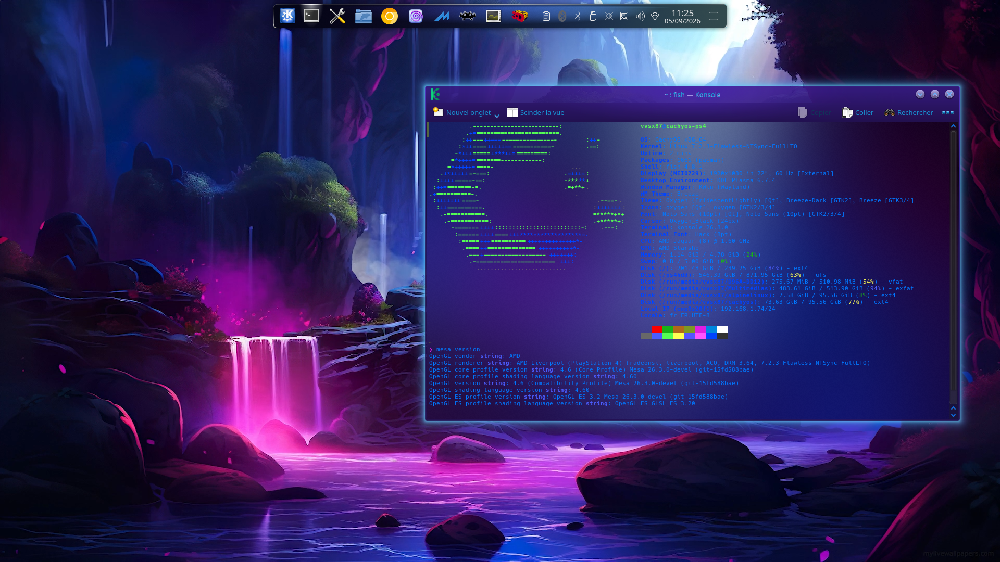

his full boot log with my banner: [flawless-bootlog.txt](docs/flawless-bootlog.txt)

## The DDR3 article

[this article](https://ps4linux.com/ps4-pro-ddr3-patch-linux-debarshi/) came out on november 5. it says a KHEOPS member made the ps4 pro ddr3 read speed go from 10.6MB/s to 504MB/s by reverse engineering the os kernel with ai, and that this makes games, shaders and swap faster.

thats not how the hardware works:

- the 1GB ddr3 on the pro belongs to the southbridge. its not the main ram. games and the gpu run from the gddr5 on the apu. fail0verflow already showed this in their [33c3 slides](https://fail0verflow.com/media/33c3-slides/): the southbridge is an arm soc with its own ddr ram, and it runs freebsd in standby mode for the background downloads
- so speeding up that ddr3 does nothing for games, shader loading or swap
- the kernel was never released, so nobody could even check the numbers
- the update in the same article already backs off and says it probably wont help games

and on november 6, when someone asked if the ddr3 patch will get source, seuros answered himself:

> it useless . It more a research exercise than something you can use.

the dev behind it replied "that's true".

the newer build was never released. an earlier one from august 28 (`6.8.12.DEB-neo-WorkStation-GPU-compute-DDR3`) is out there and already has the ddr3 driver. what it really does:

- no dma engine at all. reads and writes are a plain cpu `memcpy`
- it maps one hardcoded address, `0x80000000`, 1 GiB, as normal cached memory. it does not even ask the pci device where its window is
- that address is the southbridge memory window. mapping a pcie window as cached memory is why reads look faster
- it always takes 1 GiB, also on fat and slim consoles where the southbridge only has 256 MB behind that window

## What each side released

- KHEOPS: prebuilt bzImages only. no source, no commits, nothing to review. the code inside comes from public trees
- the ddr3 patch: no kernel, no source, only an article and a table of numbers
- seuros: on october 4 he wrote "I'm not releasing anything yet". his github has 482 public repos. every ps4 linux one is a fork of someone elses tree, the only one of his own is a list of offsets. we could not find any ps4 linux code he wrote
- this tree: every commit is public with its author, every release was booted on real consoles with logs from testers

on october 3 seuros wrote that i "could not make video working". hardware decode and encode both work here, its the first video in the showcase.

on october 4 he also said i cant make progress "while my code is hidden". his code was never public, so it was never in this tree. since then this tree got hardware video, one kernel for all southbridges, the samu crypto, baikal ethernet and flash, and the 7.3 port.

on november 1 MSI_Ins_Dir from their side wrote "our team doesn't have Baikal, and that's why we don't have any Baikal-based development". the next day saya said the same himself: "For Baikal, I haven't moved past kernel 5.4.x yet (which, incidentally, wasn't originally my own work)". so the "7.0.6 baikal" and "7.0.7 baikal" kernels vvsx87 posted in may did not come from them. in his message MSI_Ins_Dir also said we stole their work "in such a way that you can't tell it was stolen". you cant compare against code that was never published.

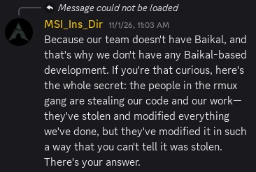

4 minutes before that message, at 10:59 the same morning, MSI_Ins_Dir wrote "I tested all southbrigde" and "The situation is different for Baikal". at 11:03 he wrote "our team doesn't have Baikal". there are only three southbridges: aeolia, belize and baikal.

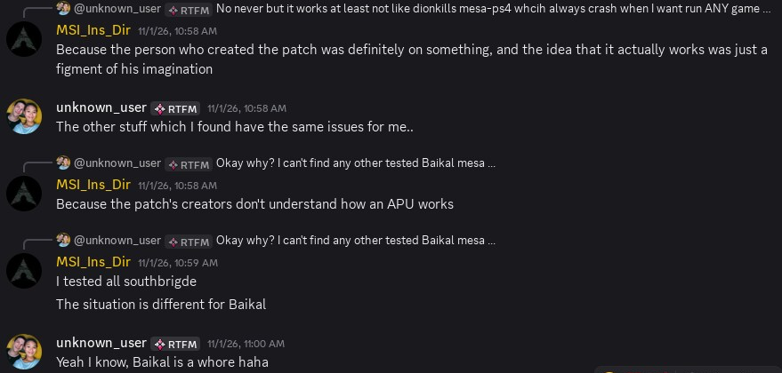

## There is nothing to steal

MSI_Ins_Dir says we are "stealing our code and our work". on october 25 saya wrote "the more we release, the more he will want to steal data and claim it as his own". on november 12 he wrote this:

> Stolen = rmux
> I have released just 6.15.4 crashniels with addons
> After i will released bzImages 7.x , i'm no stressed

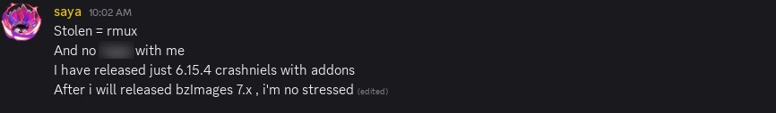

later he edited the message and added a line with a slur in it. i blurred it.

so by his own words, everything KHEOPS released is "just 6.15.4 crashniels with addons". and the 7.x plan is more bzImages, no source.

**there is nothing to steal.** 😭

- KHEOPS never published a single patch or a line of their shitty kernels. not on github, not on gitlab, not anywhere
- the binaries are crashniels public tree plus public patches. the only changes of their own are 3 small edits in the hdmi bridge, and this tree does not use a fixed mode list at all. it reads the edid from your tv
- what this tree has, KHEOPS does not: hardware video, edid, baikal
- this tree is public. every commit has my name on it, or my teams
