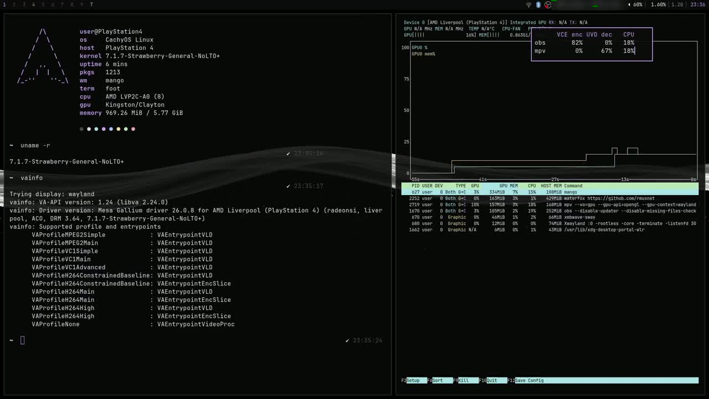
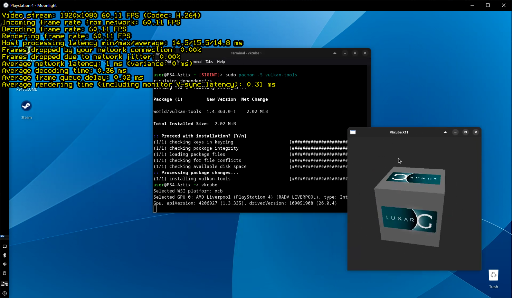
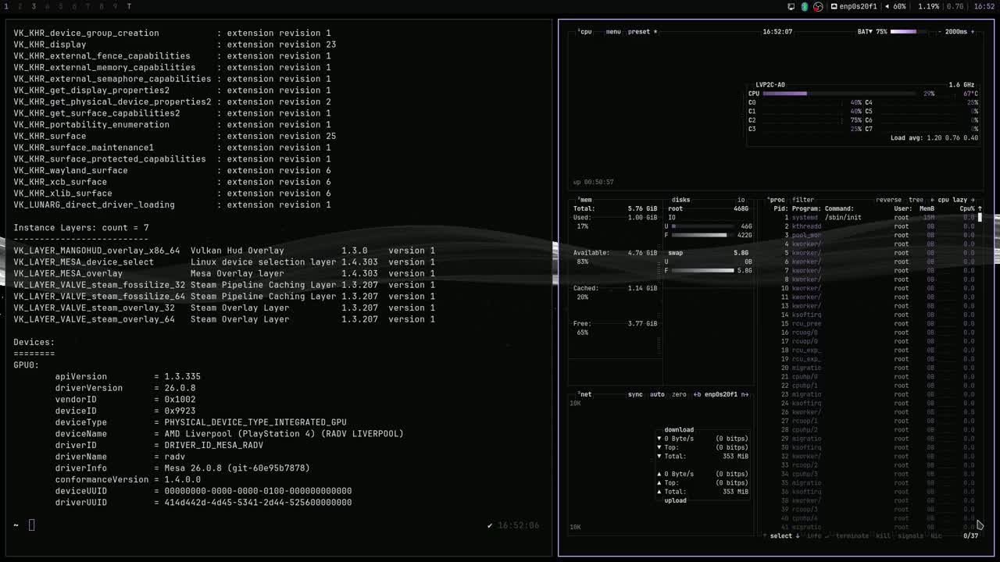
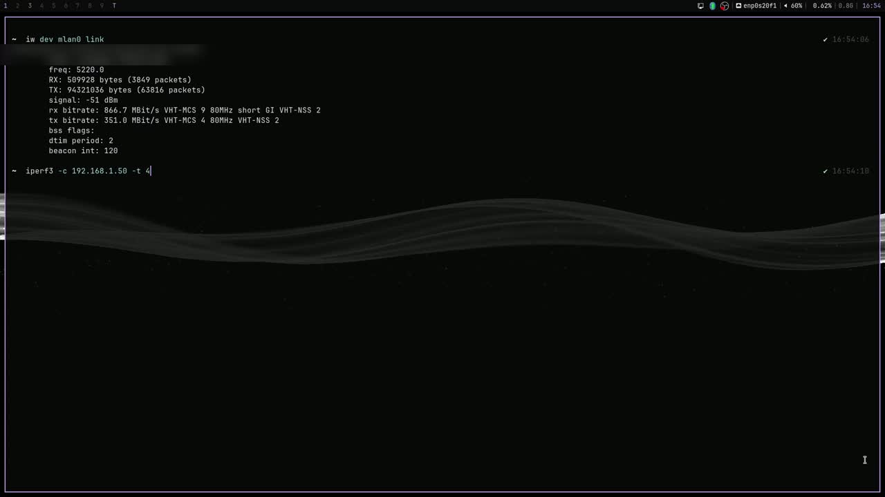

# Strawberry PS4 Linux

one kernel for every ps4. aeolia, belize and baikal. fat, slim and pro. linux 7.3.3.

before this every southbridge had its own kernel and baikal was never really fixed, almost 6 years. this tree checks the southbridge at boot and runs the right paths for it. so its just one bzImage for all of them.

## What works

- hdmi output, the edid from your tv, hotplug
- vulkan (radv) and opengl (radeonsi), gpu compute. not on pro yet, see known issues
- hardware video decode and encode (uvd and vce), so hardware transcoding works. not on pro yet
- usb, sata hdd and ssd, blu-ray drive
- ethernet. baikal with the new mts driver at full gigabit, aeolia and belize with sky2
- wifi and bluetooth, ds4 reconnects with one press
- cpu frequency scaling, fan, power led, power button, reboot and power off
- spi flash read on baikal
- tsc calibrated against the southbridge timer, high res timers on baikal

tested on baikal slim, baikal pro, belize slim and belize pro. aeolia runs the same code but nobody tested this release on aeolia yet.

## Known issues

- vulkan on pro (gladius) hangs the gpu (ring gfx timeout in vkmark), the desktop and opengl work. cause not found yet
- no hardware video on pro yet, uvd and vce are off for gladius
- 4k only up to 30 hz. no 4k60, hdr or deep color yet
- no suspend or hibernate
- the gpu clock stays at its top speed, it does not clock down when idle
- aeolia ethernet can keep one cpu core busy, fix is in progress
- samu ccp and trng are off for now, they break boot on belize slim and aeolia
- belize rtc read fails at boot, the loader sets the time instead
- dp link training errors in dmesg are harmless, display works

## Install

you need the loader and an initramfs:

- loader: [ps4-linux-loader](https://github.com/ps4-linux/ps4-linux-loader)
- initramfs: [initramfs-ps4 by GattoDev](https://github.com/GattoDev-debug/initramfs-ps4/releases/latest)

put `bzImage` and `initramfs.cpio.gz` on a fat32 usb and send the loader payload.

the loader picks the cmdline for your southbridge. if you want your own put it in `bootargs.txt` on the usb. uart console:

- baikal: `console=uart8250,mmio32,0xC890E000`
- aeolia and belize: `console=uart8250,mmio32,0xd0340000`

## Build

```
./build.sh --option 3 use=General lto=ThinLTO
```

`--option 1` builds, `--option 2` fetches firmware, `--option 3` does both. clang only. `./build.sh --help` shows the profiles. output is `out/bzImage`.

if you want to contribute fork it and open a merge request. dont base a kernel on this one, dump it into a .patch repo and call it your own work.

## Showcase

hardware transcoding on a baikal slim. obs records the screen with the vce encoder at 60fps while mpv plays a video on uvd, cpu stays low. click the picture for the video:

[](docs/hwtranscode.mp4)

streaming the ps4 desktop with moonlight, 1080p 60fps h264 from the hardware encoder, vkcube running on radv:



desktop and vulkan on 7.3.3, vulkaninfo shows radv on liverpool:

[](docs/desktop-vulkan.mp4)

usb, ethernet, wifi and bluetooth:

[](docs/usb-net-bt.mp4)

## About KHEOPS

people keep saying i stole their code. i wrote down whats really inside their kernels, what they said themselves, and the kernels that went around with my name swapped out. its all in [KHEOPS.md](KHEOPS.md).

## Credits

### PS4 Linux

- fail0verflow, the original ps4 linux
- whitehax0r, the original 5.4 baikal bringup (ps4-linux-baikal). this opened the door
- crashniels, the ps4 tree this is based on
- Package (feeRnt), original 6.15 aeolia and belize source, mt7668 wifi, ci and lots of bridge fixes
- Blyadimir, uart, usb, display, endless testing. this work wouldnt exist without him
- deWaardt, baikal hardware maintainer, early tests
- leg (eclipsed.starr, dreams-of-formaldehyde), bzImage uploads, coordination
- M H (mircoho), ioremap, ethernet and apcie fixes
- Anthony Maniatopoulos (manya4090, Manya3084), gladius gpu setup and the smu through samu, testing and logs
- Regie Vorkman (TheVorkMan, Regus Prime), dmi strings and testing
- Comfy702, mt7668 bluetooth on baikal

### Loader

- marcan, shuffle2, eeply, rancido, valeryy, ethylamine, Joonie86 (linux)
- sleirsgoevy, AlAzif, KiwiDog, Specter, Celesteblue, ChendoChap, zecoxao, SocraticBliss, ctn123 (exploits)
- bestpig, EchoStretch, EinTim23, tihmstar, ArabPixel (offsets)
- ArabPixel and me, firmware and southbridge agnostic loader

### Initramfs and guide

- GattoDev, [initramfs-ps4](https://github.com/GattoDev-debug/initramfs-ps4) (based on better-initramfs)
- DionKill, [ps4 linux setup guide](https://dionkill.github.io/ps4-linux-tutorial/)

### Team

- devs: arabpixel (ArabPixel), packagebob (feeRnt), bjhabibie
- coordination: eclipsed.starr (dreams-of-formaldehyde), hnoobi (TheVorkMan), vanillitefroyo

### Testers

- baikal: blyadimir., dewaardt, ss6530, isitnull., shyxuo, zarbok., vanixidk (vanixvanixvanix), jhuhblya, mechanical, kingabut, izanhower, sgtxkitkat, rodrigo, sudofrontman, fluffysheep
- belize: adanielg18 (angeldanielguerrerocarrera), gattodev_real (GattoDev-debug), angheloisfish, wondermine, nadaman, razzle, hnoobi (TheVorkMan), vanillitefroyo
- aeolia: rmuxnet (me), diema, lupusetflos, bjhabibie
- testers and logs: bozo.ozod, erkki_69_men.com, Bbang, gryoza, fleur, TheGreekOne, felix_suicide, tteons, Scrooge

### Special thanks

- syrianclippy, emotional support

### Maintainer

- me, Dievas (7xkq / rmux)
